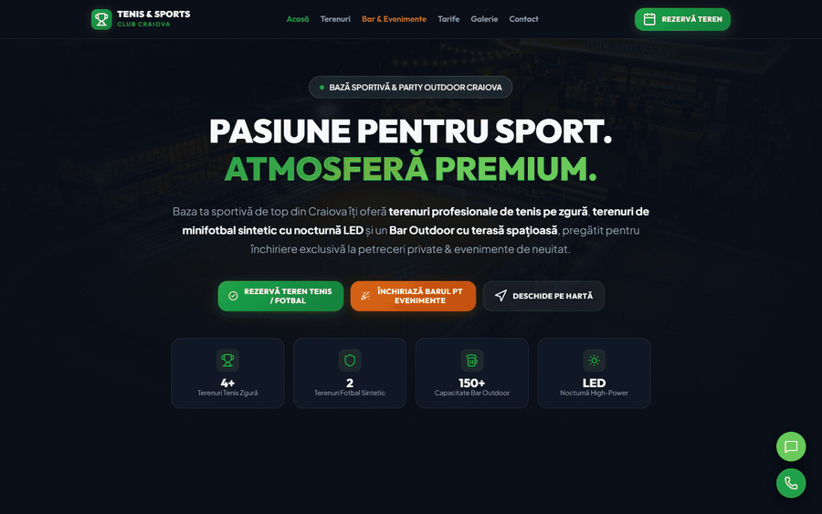

# Tennis & Sports Club: Booking Site

**A conversion-focused website for a local sports club (clay tennis courts, floodlit 5-a-side football, an outdoor bar for private events), where every booking lands as a pre-filled WhatsApp message to the owner.**

<p align="center"></p>

Small clubs don't need a booking SaaS with logins and payment fees. They need customers to book in under 30 seconds, through the channel the owner already answers all day: WhatsApp.

## Features

- **Live price calculator.** Pick the sport, time slot and duration and the price updates instantly. Rates change by time of day:

  | | day | sunset | floodlit night |
  |---|---|---|---|
  | Tennis (clay) | 60 lei/h | 70 lei/h from 18:00 | 80 lei/h from 20:00 |
  | Football (synthetic) | 140 lei/h | 160 lei/h from 17:00 | 180 lei/h from 19:00 |
  | Bar, private event | base package 500 lei | | |

- **WhatsApp booking, zero backend.** The quick form, the booking modal and the event-enquiry modal all build a structured message (sport, date, hour, duration, estimated price, name, phone) and open `wa.me` with it pre-filled. The owner receives a ready-to-confirm request.
- **Event enquiries** for the outdoor bar (birthdays, team events), with guest count and preferred date.
- **Scroll-reveal animations** with `IntersectionObserver` (with a fallback for older browsers), active-section highlighting in the nav, FAQ accordion, floating WhatsApp and call buttons.
- **Fast by construction**: semantic HTML, one CSS file with custom properties (dark glassmorphism theme), one JS file, Lucide icons, Google Fonts. No framework, no build step. Deploys to Netlify as a static folder.

## Run

Open `index.html`, or serve the folder:

```bash
python -m http.server 8000
```

Set the club's number in `app.js` (`CLUB_WHATSAPP`) and in the phone links in `index.html`. The repository uses the placeholder `+40 700 000 000`.

## Files

```
index.html   sections: hero, courts, bar & events, prices, gallery, FAQ, contact + 2 modals
styles.css   design tokens, glass panels, responsive layout
app.js       price rules, WhatsApp message builders, scroll reveal, nav state, FAQ
images/      venue photos
```

## License

MIT
